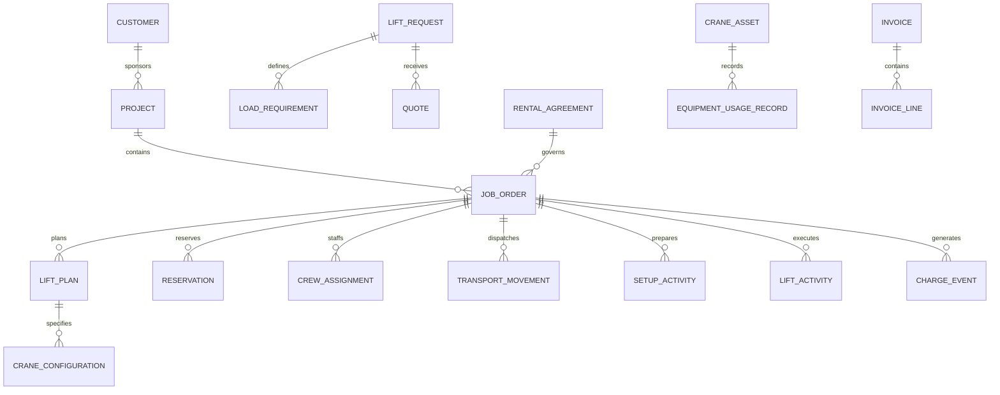

# Industrial & Commercial Crane Rental Orchestration Model Pattern: business definitions

These reusable definitions belong to the canonical model. The [industry pattern](../crane-rental-orchestration.md) supplies context, variants, selection guidance, and modeling questions. Applications select and specialize these requirements and define their own architecture.

Relationships retain their source expressions and original cardinalities; consult [the manifest](../../model/model.json) and [semantic review](../../model/integration-review.md) before interpreting unresolved compound endpoints. Lifecycle descriptions are business guidance, not implementation state machines.

## Actors and roles

| Role | Meaning |
|---|---|
| Customer | Party requesting or purchasing rental or lifting services. |
| Site Owner | Party controlling the location where work occurs. |
| General Contractor | Party coordinating the broader construction or industrial project. |
| Rental Provider | Party supplying equipment, personnel, or lifting services. |
| Sales Representative | Role qualifying demand, pricing, and commercial terms. |
| Lift Planner | Qualified role translating requirements into a Lift Plan and resource configuration. |
| Engineer | Qualified Party responsible for required engineered analysis or approval. |
| Dispatcher | Role allocating assets, transport, personnel, and timing. |
| Crane Operator | Qualified Person operating the Crane under the applicable rules. |
| Lift Director | Role directing lift execution and coordination. |
| Rigger | Qualified Person selecting, inspecting, attaching, or controlling rigging. |
| Signal Person | Qualified Person communicating movement instructions to the Operator. |
| Assembly Director | Role directing assembly, disassembly, or configuration where required. |
| Driver | Qualified Person transporting equipment or components. |
| Technician | Role inspecting, servicing, repairing, or commissioning Equipment. |
| Inspector | Qualified Party performing required inspections. |
| Subcontractor | External Party supplying equipment, transport, labor, engineering, or permits. |

Rule: a Person's application account does not establish operational qualification. Each Job Assignment must verify the required role, credential, competency, employer, jurisdiction, equipment category, and effective dates.

## Relationship model

| Source | Relationship | Target | Cardinality |
|---|---|---|---|
| Customer | owns | Customer Account | 1:M by provider |
| Customer | sponsors | Project | 1:M |
| Project | contains | Job Order | 1:M |
| Lift Request | concerns | Job Site | M:1 |
| Lift Request | contains | Load Requirement | 1:M |
| Lift Request | receives | Site Survey | 1:M |
| Lift Request | produces | Quote | 1:M |
| Quote | contains | Quote Line | 1:M |
| Accepted Quote | establishes | Rental Agreement or Job Order | 1:M |
| Rental Agreement | governs | Job Order | 1:M |
| Job Order | has | Lift Plan | 1:M versions |
| Lift Plan | references | Load Requirement | M:M |
| Lift Plan | specifies | Crane Configuration | 1:M |
| Crane Configuration | uses | Crane Asset or Equipment Model | M:1 |
| Crane Configuration | contains | Equipment Component | M:M |
| Lift Plan | supported by | Capacity Evidence | 1:M |
| Job Order | has | Resource Requirement | 1:M |
| Resource Requirement | fulfilled by | Reservation | 1:M |
| Reservation | allocates | Asset, Component, Person, or service | M:1 |
| Job Order | has | Crew Assignment | 1:M |
| Dispatch Plan | contains | Transport Movement | 1:M |
| Transport Movement | carries | Asset or Component | M:M |
| Delivery | completes | Transport Movement | M:1 |
| Job Order | has | Setup Activity | 1:M |
| Asset or Setup | receives | Inspection | 1:M |
| Inspection | contains | Inspection Finding | 1:M |
| Release for Service | applies to | Asset and Configuration | M:1 each |
| Job Order | contains | Lift Activity | 1:M |
| Lift Activity | follows | Lift Plan Version | M:1 |
| Lift Activity | uses | Crane Asset and Configuration | M:1 each |
| Lift Activity | records | Operational Observation | 1:M |
| Job Order | records | Delay, Standby, Stop-Work, or Incident | 1:M each |
| Asset | produces | Equipment Usage Record | 1:M |
| Job Order | concludes with | Teardown and Return | 1:M |
| Return | may produce | Damage Report or Maintenance Work Order | 1:M |
| Job Order | produces | Charge Event | 1:M |
| Invoice | contains | Invoice Line | 1:M |
| Invoice Line | derives from | Charge Event | M:M |
| Invoice | receives | Payment | M:M through allocation |

## Lifecycle models

### Lift request

Draft → Submitted → Qualified → Assessed → Quoted → Accepted

Exception outcomes: More Information Required; Declined; Withdrawn; Expired.

### Quote

Draft → Reviewed → Issued → Accepted → Converted

Exception outcomes: Revised; Rejected; Expired; Withdrawn; Superseded.

### Job order

Proposed → Planning → Ready for Dispatch → Mobilizing → On Site → In Service → Demobilizing → Completed → Closed

Exception outcomes: On Hold; Cancelled; Suspended; Terminated.

### Lift plan

Draft → Technical Review → Customer/Site Review → Approved → Released for Execution → Completed

Exception outcomes: Revision Required; Rejected; Suspended; Superseded; Withdrawn.

### Reservation

Requested → Tentative → Confirmed → Dispatched → Consumed → Released

Exception outcomes: Conflict; Substituted; Cancelled; No Longer Available.

### Crane asset

Available → Reserved → In Transit → On Site → In Service → Return Transit → Inspection → Available

Exception outcomes: Held; Out of Service; Maintenance; Quarantined; Retired.

### Lift activity

Planned → Briefed → Ready → In Progress → Load Placed → Completed

Exception outcomes: Delayed; Stopped; Aborted; Incident; Replanned.

### Maintenance work order

Open → Assessed → Planned → In Progress → Verification → Released → Closed

Exception outcomes: Waiting for Parts; Deferred; Outsourced; Asset Retired.

## Business events

- Lift Request Submitted, Qualified, Declined, or Withdrawn
- Site Survey Scheduled or Completed
- Load Information Verified
- Lift Classified
- Equipment Configuration Proposed or Approved
- Quote Issued, Revised, Accepted, Rejected, or Expired
- Agreement Executed
- Job Order Released
- Lift Plan Submitted, Reviewed, Approved, Revised, or Suspended
- Permit Requested, Issued, Expired, or Revoked
- Qualification Verified or Expired
- Asset Reserved, Substituted, Dispatched, Delivered, Returned, or Released
- Crew Assigned, Reassigned, Checked In, or Released
- Setup Started or Completed
- Inspection Completed; Finding Opened or Resolved
- Equipment Released for Service
- Pre-Lift Meeting Completed
- Lift Started, Stopped, Resumed, Completed, or Aborted
- Weather Hold, Delay, Standby, Breakdown, or Incident Recorded
- Teardown Completed
- Damage Detected
- Maintenance Work Order Opened or Closed
- Usage, Fuel, Labor, or Charge Event Recorded
- Invoice Issued, Disputed, Adjusted, or Paid

## Baseline business and integrity rules

1. A Lift Request must identify the Customer, Job Site, requested period, service model, and sufficient load and movement information before equipment is committed.
2. Customer-supplied load, site, access, ground, utility, and schedule information must retain source and verification status.
3. Equipment selection must trace to the verified Load Requirement, required radius and height, configuration, capacity evidence, deductions, site conditions, and applicable planning rules.
4. A Quote must identify assumptions, exclusions, validity period, configuration basis, included services, rates, and responsibility boundaries.
5. A Job Order cannot become ready for dispatch until required commercial approval, resource reservations, planning requirements, and credit conditions are satisfied or explicitly waived by authority.
6. Each reserved Asset and Component must be compatible, available, certified, and free of conflicting reservations for the required period.
7. Every operational Person must have verified qualifications for the assigned role, equipment, employer, jurisdiction, and work date.
8. The released Lift Plan version must identify load, equipment, actual configuration, site position, radius, rigging, ground support, roles, communications, hazards, controls, limits, and approvals required by the Lift Classification.
9. Permit, engineering, route, traffic, utility, and site-control requirements must be satisfied before the stage they govern.
10. Delivery, setup, inspection, release for service, and Lift execution are independent milestones with separate evidence.
11. Equipment cannot be released for service while a blocking Inspection Finding, expired certification, incompatible configuration, or unresolved safety restriction exists.
12. The actual Crane Configuration must be verified against the released Lift Plan before execution.
13. A material change to load, radius, configuration, rigging, ground, access, weather, personnel, or method triggers review and, where required, a revised approval.
14. Stop-work authority is available to designated participants; resumption must record corrected conditions and authorized release.
15. Lift Activities preserve actual start/end times, Asset, configuration, responsible roles, observations, delays, outcome, and Plan version.
16. Usage, standby, labor, travel, overtime, fuel, transport, and damage quantities must trace to authoritative evidence and applicable Agreement terms.
17. Substituted Equipment or personnel must pass the same suitability, compatibility, qualification, planning, notification, and approval checks as the original reservation.
18. Return condition is compared with delivery condition; damage responsibility and charges require evidence, review, and contractual basis.
19. An Asset with a blocking defect or due mandatory maintenance cannot return to Available status until authorized release.
20. Every Invoice Line must trace to approved Charge Events, rates, quantities, taxes, and Agreement or Change Order terms.
21. Signed plans, inspections, logs, tickets, and incident evidence are immutable; corrections use attributed amendments or superseding versions.
22. Operational and personal information access is governed by role, purpose, contract, jurisdiction, and minimum-necessary scope.
