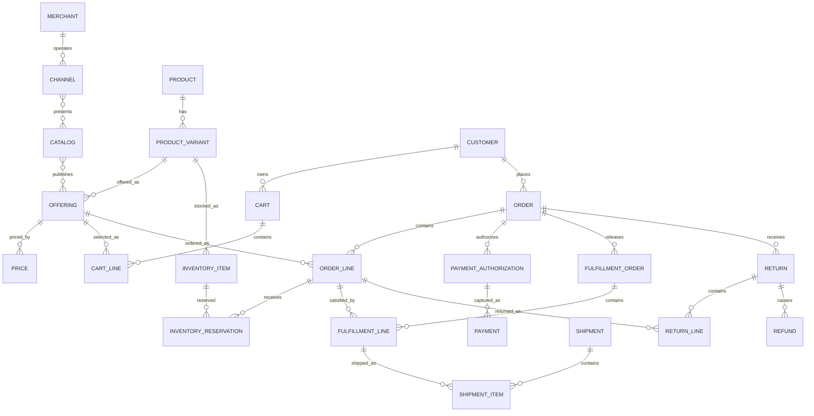

# E-Commerce Model Pattern: business definitions

These reusable definitions belong to the canonical model. The [industry pattern](../e-commerce.md) supplies context, variants, selection guidance, and modeling questions. Applications select and specialize these requirements and define their own architecture.

Relationships retain their source expressions and original cardinalities; consult [the manifest](../../model/model.json) and [semantic review](../../model/integration-review.md) before interpreting unresolved compound endpoints. Lifecycle descriptions are business guidance, not implementation state machines.

## Actors and roles

| Role | Meaning |
|---|---|
| Customer | Party that shops, orders, receives value, or pays. |
| Buyer | Party Role authorized to place an Order. |
| Recipient | Party or contact designated to receive fulfillment. |
| Merchant | Party responsible for the storefront and customer commercial relationship. |
| Seller | Party supplying an Offering in a marketplace. |
| Fulfillment Provider | Party that picks, packs, ships, activates, or delivers. |
| Carrier | Party transporting a Shipment. |
| Payment Provider | Party authorizing, capturing, settling, or refunding money. |

Rule: Customer, Buyer, Recipient, and Payer may be different Parties or roles.

## Standard relationship model

| Source | Relationship | Target | Cardinality |
|---|---|---|---|
| Merchant | operates | Channel | 1:M |
| Channel | presents | Catalog | M:M |
| Catalog | contains | Category | 1:M |
| Category | classifies | Offering | M:M |
| Product | has | Product Variant | 1:M |
| Offering | offers | Product or Product Variant | M:1 |
| Catalog | publishes | Offering | M:M |
| Offering | has | Price | 1:M |
| Promotion | applies to | Offering, Cart, Order, or Order Line | M:M |
| Customer | owns | Cart | 1:M |
| Cart | contains | Cart Line | 1:M |
| Cart Line | selects | Offering | M:1 |
| Cart | converts to | Order | 1:0..1 |
| Customer | places | Order | 1:M |
| Order | contains | Order Line | 1:M |
| Order Line | snapshots | Offering | M:1 |
| Order | uses | Order Address | 1:M |
| Inventory Item | stocks | Product Variant | M:1 |
| Inventory Reservation | reserves | Inventory Item | M:1 |
| Order Line | receives | Inventory Reservation | 1:M |
| Order | receives | Payment Authorization | 1:M |
| Payment Authorization | may produce | Payment | 1:M |
| Payment | applies through | Payment Allocation | 1:M |
| Payment Allocation | settles | Order, Invoice, or Charge | M:1 |
| Order | releases | Fulfillment Order | 1:M |
| Fulfillment Order | contains | Fulfillment Line | 1:M |
| Fulfillment Line | satisfies | Order Line | M:1 |
| Shipment | contains | Shipment Item | 1:M |
| Shipment Item | fulfills | Fulfillment Line | M:1 |
| Shipment | results in | Delivery | 1:M |
| Order or Order Line | receives | Cancellation | 1:M |
| Order | receives | Return | 1:M |
| Return | contains | Return Line | 1:M |
| Return Line | refers to | Order Line | M:1 |
| Return | may cause | Refund | 1:M |
| Customer | opens | Customer Case | 1:M |

## Lifecycle models

### Cart

Active → Converted | Abandoned | Expired

### Order

Draft → Submitted → Accepted → Allocated → Partially Fulfilled → Fulfilled → Completed

Exception outcomes: On Hold; Partially Cancelled; Cancelled.

### Payment authorization

Requested → Authorized → Partially Captured → Captured

Exception outcomes: Declined; Expired; Voided.

### Fulfillment

Planned → Released → In Progress → Partially Fulfilled → Fulfilled

Exception outcomes: On Hold; Failed; Cancelled.

### Shipment

Planned → Packed → Shipped → In Transit → Delivered

Exception outcomes: Delayed; Delivery Failed; Lost; Returned.

### Return

Requested → Authorized → In Transit → Received → Inspected → Resolved

Exception outcomes: Rejected; Cancelled.

## Business events

- Product Published
- Price Activated
- Promotion Activated
- Item Added to Cart
- Checkout Started
- Order Submitted
- Order Accepted or Rejected
- Inventory Reserved or Released
- Payment Authorized, Declined, Captured, or Failed
- Fulfillment Released
- Shipment Dispatched
- Delivery Confirmed or Failed
- Cancellation Requested or Accepted
- Return Requested, Authorized, Received, or Rejected
- Refund Requested or Completed

Events record what happened; lifecycle transitions define what changes are allowed because of those events.

## Baseline business and integrity rules

1. An Offering must be active in the selected Channel, market, and time period before it can be ordered.
2. Checkout must revalidate price, promotion, tax, inventory, entitlement, and delivery promise.
3. An accepted Order retains the commercial snapshots necessary to reproduce its totals.
4. Order Total = line totals + charges + tax − discounts, subject to declared rounding rules.
5. Reserved inventory cannot exceed available inventory unless backorder rules explicitly permit it.
6. The same Order Line may be split across several Fulfillment Orders and Shipments.
7. Fulfilled quantity plus cancelled quantity cannot exceed ordered quantity.
8. Captured payment cannot exceed the amount authorized unless the payment method explicitly supports incremental authorization.
9. Refunds cannot exceed captured value net of prior refunds, unless an explicit goodwill-credit policy applies.
10. Return quantity cannot exceed delivered quantity net of prior accepted returns.
11. Every financial adjustment must retain its reason, source, currency, and calculation evidence.
12. Raw card credentials must not be stored; retain provider tokens and masked display data only.
