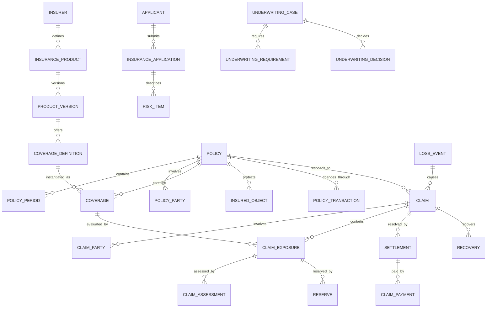

# Insurance Model Pattern: business definitions

These reusable definitions belong to the canonical model. The [industry pattern](../insurance.md) supplies context, variants, selection guidance, and modeling questions. Applications select and specialize these requirements and define their own architecture.

Relationships retain their source expressions and original cardinalities; consult [the manifest](../../model/model.json) and [semantic review](../../model/integration-review.md) before interpreting unresolved compound endpoints. Lifecycle descriptions are business guidance, not implementation state machines.

## Insurance roles

| Role | Meaning |
|---|---|
| Insurer | Party accepting insurance risk and issuing the Policy. |
| Applicant | Party seeking insurance and supplying underwriting information. |
| Policyholder | Party that owns or controls the Policy. |
| Named Insured | Party explicitly granted insured status by the Policy. |
| Additional Insured | Party receiving defined protection without being the primary Policyholder. |
| Beneficiary | Party entitled to receive a benefit under defined conditions. |
| Producer | Agent, broker, or other intermediary distributing or servicing insurance. |
| Underwriter | Role evaluating risk and deciding whether and on what terms to insure it. |
| Claimant | Party seeking compensation or another benefit. |
| Claim Adjuster | Role investigating and evaluating a Claim. |
| Service Provider | Repairer, medical provider, assessor, investigator, lawyer, or other claim participant. |
| Reinsurer | Party accepting a portion of an Insurer's risk. |

Rule: Party identity is independent of role. One Party may perform several roles, and roles may change over time or by Policy and Claim.

## Relationship model

| Source | Relationship | Target | Cardinality |
|---|---|---|---|
| Insurer | defines | Insurance Product | 1:M |
| Insurance Product | has | Product Version | 1:M |
| Product Version | contains | Coverage Definition | 1:M |
| Insurance Offering | makes available | Product Version | M:1 |
| Quote | contains | Quote Option | 1:M |
| Quote Option | proposes | Coverage configuration | 1:M |
| Applicant | submits | Insurance Application | 1:M |
| Insurance Application | describes | Risk Item | 1:M |
| Underwriting Case | evaluates | Application, Quote, or Policy Transaction | M:1 |
| Underwriting Case | contains | Underwriting Requirement | 1:M |
| Underwriting Case | produces | Underwriting Decision | 1:M |
| Accepted Quote/Application | produces | Policy | 1:0..1 |
| Policy | contains | Policy Period | 1:M |
| Policy | has | Policy Party | 1:M |
| Policy | covers | Insured Object | M:M through Coverage |
| Policy | contains | Coverage | 1:M |
| Coverage | derives from | Coverage Definition | M:1 |
| Coverage | has | Coverage Term or Exclusion | 1:M |
| Policy | changes through | Policy Transaction | 1:M |
| Policy Transaction | may create | Endorsement | 1:0..M |
| Coverage or Policy Period | produces | Premium | 1:M |
| Billing Account | bills | Policy | 1:M |
| Billing Account | receives | Invoice and Payment | 1:M each |
| Producer | earns | Commission | 1:M |
| Loss Event | gives rise to | Claim | 1:M |
| Policy | responds to | Claim | 1:M |
| Claim | has | Claim Party | 1:M |
| Claim | contains | Claim Exposure | 1:M |
| Claim Exposure | evaluates | Coverage | M:1 |
| Claim or Exposure | receives | Claim Assignment | 1:M |
| Claim Exposure | receives | Claim Assessment | 1:M |
| Claim | contains | Evidence Item and Claim Note | 1:M each |
| Claim Exposure | has | Reserve | 1:M over time |
| Claim or Exposure | resolves through | Settlement | 1:M |
| Settlement or approved expense | produces | Claim Payment | 1:M |
| Claim | may produce | Recovery | 1:M |
| Reinsurance Contract | contains | Reinsurance Coverage | 1:M |
| Policy or portfolio | allocates through | Cession | 1:M |
| Claim | may produce | Reinsurance Claim | 1:M |

## Lifecycle models

### Quote

Draft → Rated → Offered → Accepted

Exception outcomes: Referred; Declined; Expired; Withdrawn; Superseded.

### Insurance application

Draft → Submitted → In Review → Decision Made

Decision outcomes: Accepted; Accepted with Conditions; Declined; Postponed; Withdrawn.

### Policy

Proposed → Bound → Issued → Active → Expired

Exception outcomes: Pending Cancellation; Cancelled; Lapsed; Reinstated; Non-Renewed; Rewritten.

### Claim

Reported → Open → Assigned → Investigating → Evaluating → Decision Made → Settling → Closed

Exception outcomes: Coverage Question; Litigation; Fraud Review; Denied; Withdrawn; Reopened.

### Claim exposure

Open → Investigating → Evaluated → Approved/Denied → Settled → Closed

### Reserve

Proposed → Approved → Active → Adjusted → Released → Closed

### Settlement

Draft → Reviewed → Offered → Accepted → Approved → Paid → Completed

Exception outcomes: Rejected; Withdrawn; Voided.

## Business events

- Quote Requested, Rated, Offered, Accepted, Declined, or Expired
- Application Submitted
- Underwriting Requirement Requested or Satisfied
- Underwriting Decision Made
- Policy Bound, Issued, Endorsed, Renewed, Cancelled, Reinstated, or Expired
- Premium Calculated, Billed, Earned, Refunded, or Written Off
- Payment Received, Reversed, or Allocated
- Loss Reported
- Claim Opened, Assigned, Denied, Reopened, or Closed
- Evidence Received
- Coverage Determined
- Liability or Damage Assessed
- Reserve Established, Increased, Decreased, or Released
- Settlement Offered, Accepted, Approved, or Voided
- Claim Payment Issued, Stopped, or Recovered
- Fraud Referral Opened or Resolved
- Recovery Identified or Received
- Reinsurance Notice or Claim Submitted

## Baseline business and integrity rules

1. A Policy must identify the issuing Insurer, Product Version, Policy period, Policyholder, currency, and at least one Coverage before issuance.
2. Product, form, rate, and Coverage versions used by a Quote or Policy must be effective for its jurisdiction and transaction date.
3. Binding and underwriting decisions must identify the actor, authority, inputs, rules, rationale, and time.
4. A Coverage cannot extend beyond its Policy Period unless explicitly modeled as an extended reporting or benefit provision.
5. Policy changes are represented by effective-dated Policy Transactions; historical contractual versions are preserved.
6. Premium calculations retain rating inputs, plan version, adjustments, taxes, fees, and rounding evidence.
7. A Claim must identify a Loss Event or documented benefit-triggering circumstance and the Policy being invoked.
8. Claim coverage evaluation must use the Policy and Coverage terms effective for the relevant Loss date or trigger.
9. Authorization to pay is independent of coverage evaluation, reserve approval, and settlement authority.
10. Claim Payments cannot exceed the approved Settlement or payable amount net of prior payments, deductibles, limits, and recoveries unless a separately authorized expense applies.
11. Reserve changes preserve history, reason, authority, currency, and prior amount.
12. Claim denial must record the Coverage, exclusion, condition, evidence, authority, and rationale supporting the decision.
13. Finalized Claim evidence and decisions are corrected by amendment or supersession, not destructive overwrite.
14. Duplicate Claims and duplicate payments must be detected before approval.
15. Party access is governed by role, assignment, purpose, confidentiality, and minimum-necessary scope.
16. Financial postings, Claim Payments, Recoveries, commissions, and reinsurance amounts must reconcile to their source transactions.
