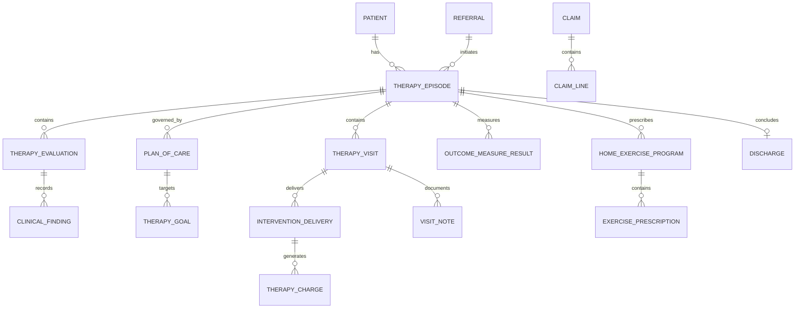

# Physical Therapy Clinic Model Pattern: business definitions

These reusable definitions belong to the canonical model. The [industry pattern](../physical-therapy-clinic.md) supplies context, variants, selection guidance, and modeling questions. Applications select and specialize these requirements and define their own architecture.

Relationships retain their source expressions and original cardinalities; consult [the manifest](../../model/model.json) and [semantic review](../../model/integration-review.md) before interpreting unresolved compound endpoints. Lifecycle descriptions are business guidance, not implementation state machines.

## Actors and roles

| Role | Meaning |
|---|---|
| Patient | Person receiving physical therapy evaluation or treatment. |
| Physical Therapist | Licensed Provider accountable for evaluation, clinical judgment, and the Plan of Care as permitted by law. |
| Physical Therapist Assistant | Provider delivering delegated care under the required supervision. |
| Referring Provider | Provider requesting therapy or supplying a medical referral. |
| Clinic Administrator | Role managing registration, scheduling, documents, billing, and clinic operations. |
| Caregiver or Representative | Party supporting the Patient or acting under legal authority. |
| Payer | Party adjudicating or funding covered services. |
| Guarantor | Party responsible for amounts not paid by a Payer. |
| Employer or Case Manager | Party coordinating occupational, disability, or injury-related care. |
| Interpreter | Party supporting accessible communication. |

Rule: Person, Patient, Provider, employee, application user, and billing Party are distinct roles. One Party may perform several roles, and every clinical role must be supported by active credentials, organization context, scope, and effective dates.

## Relationship model

| Source | Relationship | Target | Cardinality |
|---|---|---|---|
| Physical Therapy Clinic | operates | Clinic Location | 1:M |
| Therapy Provider | receives | Provider Assignment | 1:M |
| Patient | has | Therapy Episode | 1:M |
| Referral | may initiate | Therapy Episode | 1:0..M |
| Therapy Episode | concerns | Presenting Concern | 1:M |
| Therapy Episode | has | Precaution or Contraindication | 1:M |
| Therapy Episode | has | Functional Limitation | 1:M |
| Therapy Episode | contains | Therapy Evaluation | 1:M |
| Therapy Evaluation | records | Clinical Finding | 1:M |
| Therapy Evaluation | produces | Therapy Assessment | 1:M |
| Therapy Episode | has | Outcome Measure Result | 1:M |
| Therapy Episode | governed by | Plan of Care | 1:M versions |
| Plan of Care | contains | Therapy Goal | 1:M |
| Therapy Goal | receives | Goal Progress | 1:M |
| Plan of Care | contains | Treatment Plan Item | 1:M |
| Plan of Care | receives | Approval or Certification | 1:M |
| Therapy Appointment | may result in | Therapy Visit | 1:0..1 |
| Therapy Episode | contains | Therapy Visit | 1:M |
| Therapy Visit | has | Visit Note | 1:M versions |
| Therapy Visit | contains | Intervention Delivery | 1:M |
| Intervention Delivery | instantiates | Intervention Definition | M:1 |
| Intervention Delivery | supports | Therapy Goal | M:M |
| Home Exercise Program | contains | Exercise Prescription | 1:M |
| Exercise Prescription | references | Exercise Definition | M:1 |
| Therapy Episode | has | Home Exercise Program | 1:M versions |
| Home Exercise Program | receives | Home Program Activity | 1:M |
| Therapy Episode | receives | Progress Evaluation | 1:M |
| Therapy Episode | concludes with | Discharge | 1:0..1 |
| Discharge | produces | Discharge Summary | 1:1 |
| Eligibility Verification | evaluates | Coverage | M:1 |
| Therapy Authorization | authorizes | Episode, Visit, or Service | 1:M |
| Intervention Delivery | produces | Therapy Charge | 1:M |
| Claim | contains | Claim Line | 1:M |
| Claim Line | references | Therapy Charge | M:1 |
| Claim | receives | Adjudication | 1:M |
| Adjudication or Invoice | receives | Payment | 1:M |

## Lifecycle models

### Referral

Received → Reviewed → Accepted → Scheduled → Fulfilled

Exception outcomes: More Information Required; Declined; Expired; Cancelled; Redirected.

### Patient intake

Started → In Progress → Ready for Review → Complete

Exception outcomes: On Hold; Incomplete; Withdrawn.

### Therapy authorization

Draft → Submitted → In Review → Approved → Active → Exhausted/Expired

Exception outcomes: Partially Approved; Denied; Appealed; Cancelled.

### Therapy episode

Proposed → Intake → Evaluation → Active Treatment → Progress Review → Discharge Pending → Closed

Exception outcomes: Waitlisted; On Hold; Transferred; Cancelled; Administrative Closure; Reopened.

### Plan of care

Draft → Reviewed → Active → Revised → Completed

Exception outcomes: Awaiting Certification; Rejected; On Hold; Discontinued; Superseded.

### Therapy goal

Proposed → Active → Progressing → Met → Closed

Exception outcomes: Not Met; Regressed; Deferred; Discontinued; Superseded.

### Therapy appointment

Requested → Booked → Confirmed → Arrived → Fulfilled

Exception outcomes: Waitlisted; Rescheduled; Cancelled; Late Cancellation; No Show.

### Therapy visit

Planned → Arrived → In Progress → Documentation Pending → Completed

Exception outcomes: Cancelled; Interrupted; Entered in Error.

### Visit note

Draft → In Review → Signed → Final

Correction outcomes: Amended; Corrected; Superseded; Entered in Error.

### Discharge

Proposed → Reviewed → Completed → Follow-up Pending → Closed

Exception outcomes: Deferred; Reopened.

## Business events

- Referral Received, Accepted, Declined, Expired, or Fulfilled
- Patient Intake Started or Completed
- Eligibility Verified
- Authorization Requested, Approved, Denied, Extended, Exhausted, or Expired
- Appointment Requested, Booked, Confirmed, Rescheduled, Cancelled, or Missed
- Patient Arrived
- Initial Evaluation Started, Signed, or Amended
- Precaution or Contraindication Identified
- Plan of Care Created, Certified, Activated, Revised, or Completed
- Therapy Goal Activated, Progressed, Met, Not Met, or Discontinued
- Therapy Visit Started or Completed
- Intervention Delivered
- Home Exercise Program Issued or Revised
- Outcome Measure Recorded
- Progress Evaluation Completed
- Adverse Event Recorded or Escalated
- Additional Visits Requested
- Patient Placed on Hold, Transferred, or Discharged
- Charge Created, Corrected, or Voided
- Claim Submitted, Rejected, Adjudicated, Denied, or Appealed
- Patient Invoice Issued
- Payment Received, Reversed, or Allocated
- Clinical Record Accessed, Disclosed, Signed, or Amended

## Baseline business and integrity rules

1. Every Therapy Episode must identify the Patient, responsible clinic, primary concern, managing Therapist, start date, and access basis such as Referral or direct access.
2. A Provider may evaluate, treat, delegate, supervise, or sign only within an active role, credential, organization, jurisdiction, and permitted scope.
3. Referral requirements are evaluated independently from payer authorization and clinical need.
4. An Initial Evaluation must precede active treatment unless an explicitly authorized screening, emergency, or protocol exception applies.
5. A Plan of Care must identify its author, effective period, frequency, duration, goals, intended interventions, precautions, and skilled-need rationale.
6. Only one Plan of Care version is authoritative for a given Episode and effective time; revisions preserve prior versions.
7. Each Therapy Goal must be measurable or explicitly qualitative, linked to a functional concern, and assigned a target or review condition.
8. A Therapy Appointment is a plan; a Therapy Visit records actual care. Billing cannot rely on Appointment status alone.
9. A completed Therapy Visit must identify the treating Provider, Patient, Episode, start and end time, location or channel, services delivered, Patient response, and next plan.
10. Intervention Delivery must record sufficient quantity, time, units, parameters, Provider, supervision, and response to support clinical and billing requirements.
11. Timed and untimed service units are calculated under the applicable payer, contract, and jurisdiction rules, with the calculation evidence retained.
12. A Physical Therapist Assistant or delegated role may provide only interventions permitted by the active Plan, delegation, supervision, and scope rules.
13. Outcome Measure Results preserve instrument name, version, date, score, method, respondent, and interpretation.
14. Progress Evaluation must compare current status with relevant baselines, prior measures, goals, attendance, intervention response, and authorization usage.
15. A Home Exercise Program is versioned; changes preserve prior instructions and identify the prescribing Provider and effective date.
16. A precaution, contraindication, red flag, or Adverse Event requiring escalation must prevent incompatible treatment until appropriately resolved.
17. Signed clinical notes are immutable; corrections use attributed amendments or superseding versions with reason and time.
18. Every Therapy Charge must trace to a completed, documented service and the responsible Provider, date, location, code, and units.
19. A Claim Line must trace to a valid Charge, Visit, diagnosis or reason, and authorization when required.
20. Used visits or units cannot exceed an active Authorization without a documented exception, alternate payer, or Patient financial agreement.
21. Discharge must record reason, functional status, goal outcomes, remaining limitations, home instructions, precautions, and recommended follow-up.
22. Patient information access and disclosure must be governed by role, purpose, consent or other authority, minimum-necessary scope, and immutable audit evidence.
