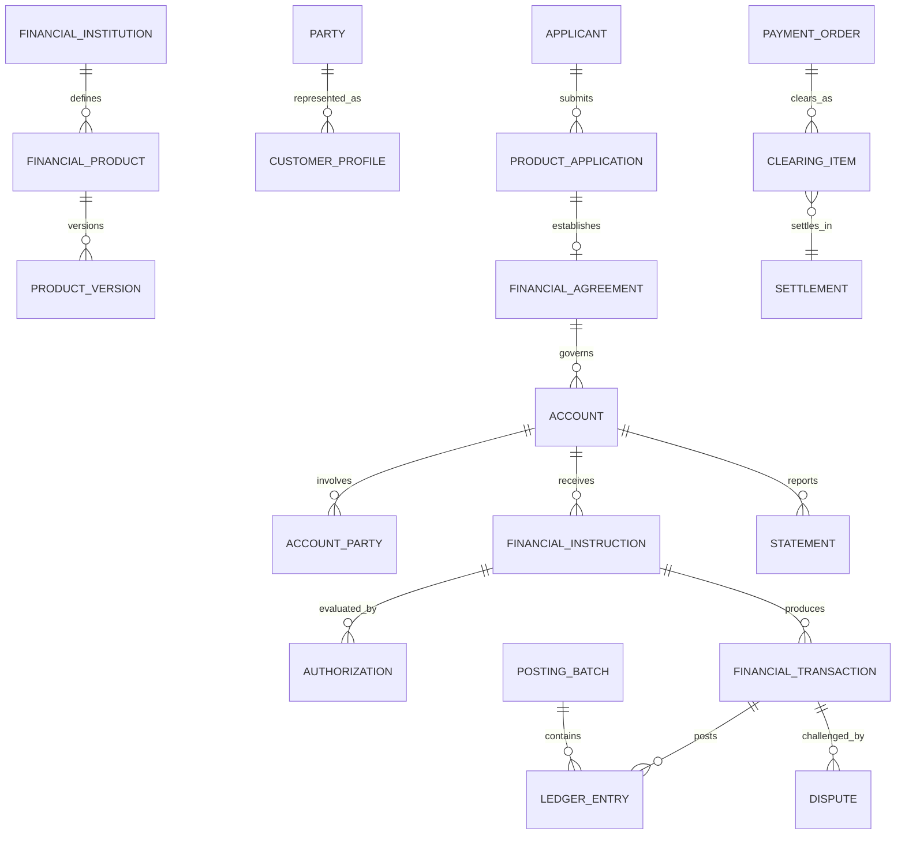

# Financial Services Model Pattern: business definitions

These reusable definitions belong to the canonical model. The [industry pattern](../../../industry-patterns/financial-services.md) supplies context, variants, selection guidance, and modeling questions. Applications select and specialize these requirements and define their own architecture.

Relationships retain their source expressions and original cardinalities; consult [the manifest](../../model.json) and [semantic review](../../integration-review.md) before interpreting unresolved compound endpoints. Lifecycle descriptions are business guidance, not implementation state machines.

## Financial-services roles

| Role | Meaning |
|---|---|
| Financial Institution | Regulated or authorized Party providing financial services. |
| Customer | Party receiving or applying for a financial service. |
| Applicant | Party submitting a product or account application. |
| Account Owner | Party holding legal or beneficial ownership of an Account. |
| Authorized Signer | Party permitted to issue defined Instructions on an Account. |
| Beneficial Owner | Natural person who ultimately owns or controls a Customer or assets. |
| Beneficiary | Party intended to receive money, assets, or contractual benefit. |
| Payer | Party whose funds or credit support a Payment. |
| Payee | Party designated to receive a Payment. |
| Borrower | Party obligated under a credit Agreement. |
| Guarantor | Party promising performance of another Party's obligation. |
| Advisor | Party or role providing regulated financial guidance. |
| Custodian | Party safeguarding financial assets. |
| Correspondent Institution | Institution providing services to another institution. |
| Compliance Officer | Role reviewing due diligence, sanctions, monitoring, or reporting decisions. |

Rule: Party identity is independent of role. A Party may hold several roles, and every role is scoped and effective-dated by relationship, Account, Agreement, or Transaction.

## Relationship model

| Source | Relationship | Target | Cardinality |
|---|---|---|---|
| Financial Institution | defines | Financial Product | 1:M |
| Financial Product | has | Product Version | 1:M |
| Financial Offering | makes available | Product Version | M:1 |
| Party | has | Customer Profile | 1:M by institution |
| Applicant | submits | Product Application | 1:M |
| Due Diligence Case | evaluates | Customer, Application, or relationship | M:1 |
| Customer | has | Beneficial Ownership | 1:M |
| Accepted Application | establishes | Financial Agreement | 1:0..M |
| Financial Agreement | governs | Account | 1:M |
| Account | has | Account Party | 1:M |
| Account | relates to | Account | M:M through Account Relationship |
| Party | grants | Mandate | 1:M |
| Mandate | authorizes | Party on Account | M:M |
| Account | has | Balance, Limit, and Hold | 1:M each |
| Account or Party | submits | Financial Instruction | 1:M |
| Instruction | receives | Authorization | 1:M |
| Instruction | produces | Financial Transaction | 1:0..M |
| Financial Transaction | produces | Ledger Entry | 1:M |
| Posting Batch | contains | Ledger Entry | 1:M |
| Financial Transaction | relates to | Financial Transaction | M:M |
| Payment Order | has | Payment Party | 1:M |
| Payment Order | produces | Financial Transaction | 1:M |
| Payment Order | exchanges through | Clearing Item | 1:M |
| Clearing Item | resolves through | Settlement | M:1 |
| Reconciliation | compares | Transactions, entries, or external items | 1:M |
| Reconciliation | identifies | Reconciliation Exception | 1:M |
| Credit Facility | governs | Loan | 1:M |
| Loan | has | Repayment Schedule | 1:M versions |
| Repayment Schedule | contains | Scheduled Payment | 1:M |
| Credit obligation | is supported by | Collateral | M:M |
| Order | executes as | Trade | 1:0..M |
| Trade | changes | Position | M:M |
| Account | produces | Statement | 1:M |
| Transaction | may be challenged by | Dispute | 1:M |
| Dispute | may produce | Adjustment | 1:M |

## Lifecycle models

### Product application

Draft → Submitted → Due Diligence → Decision Made → Agreement Established

Exception outcomes: More Information Required; Referred; Declined; Withdrawn; Expired.

### Customer relationship

Prospect → Pending Verification → Active → Restricted → Dormant → Closed

Exception outcomes: Review Required; Exit Pending; Prohibited.

### Financial agreement

Proposed → Approved → Effective → Suspended → Matured/Terminated

Possible return: Suspended → Effective.

### Account

Pending → Open → Active → Restricted/Frozen → Dormant → Closed

Exception outcomes: Blocked; Escheatment Pending; Written Off.

### Financial instruction

Received → Validating → Authorized → Processing → Completed

Exception outcomes: Pending Approval; Declined; Cancelled; Expired; Failed; Returned.

### Financial transaction

Pending → Authorized → Booked → Posted → Cleared → Settled → Final

Correction outcomes: Reversed; Returned; Adjusted; Disputed.

### Payment order

Initiated → Accepted → Authorized → Submitted → Cleared → Settled → Completed

Exception outcomes: Rejected; Cancelled; Failed; Returned; Recalled.

### Dispute

Opened → Acknowledged → Investigating → Decision Made → Adjustment/Recovery → Closed

Exception outcomes: Withdrawn; Escalated; Reopened.

## Business events

- Customer Application Submitted, Approved, Referred, Declined, or Withdrawn
- Identity Evidence Received or Verified
- Due Diligence Review Opened, Completed, or Escalated
- Screening Match Detected or Disposed
- Financial Agreement Established, Amended, Suspended, or Terminated
- Account Opened, Activated, Restricted, Frozen, Dormant, or Closed
- Account Party or Mandate Added, Changed, or Revoked
- Limit Established, Changed, Breached, or Released
- Hold Placed, Adjusted, Expired, Captured, or Released
- Instruction Received, Authorized, Declined, Cancelled, or Completed
- Transaction Booked, Posted, Reversed, Returned, Adjusted, or Settled
- Fee Assessed, Waived, Refunded, or Written Off
- Interest Accrued, Capitalized, Paid, or Corrected
- Payment Submitted, Cleared, Settled, Returned, Recalled, or Rejected
- Reconciliation Exception Detected or Resolved
- Statement Generated or Delivered
- Dispute Opened, Decided, Adjusted, or Closed
- Suspicious Activity Alert or Fraud Case Opened, Escalated, or Closed
- Regulatory Report Submitted or Corrected

## Baseline business and integrity rules

1. A Financial Agreement must identify the institution, Customer or obligated Parties, Product Version, governing terms, currency policy, and effective date before activation.
2. Product, pricing, disclosure, eligibility, and accounting-rule versions must be effective for the jurisdiction and transaction date.
3. Customer onboarding decisions preserve identity evidence, beneficial ownership, screening, risk assessment, reviewer, authority, rationale, and time.
4. Every Account Party role, ownership interest, signing authority, and Mandate is scoped and effective-dated.
5. Account status controls permitted operations; restrictions and freezes must identify source, reason, authority, scope, and duration.
6. An Instruction must preserve initiator, channel, received time, source reference, requested action, and authenticated authority.
7. Authorization must check the applicable mandate, Account status, limits, available funds or credit, product rules, and required risk controls.
8. Financial Transactions are immutable business records; corrections use linked reversals, returns, or adjustments.
9. Every posted Transaction must produce Ledger Entries whose debits and credits balance within the defined currency and accounting rules.
10. Booking date, value date, transaction time, posting time, clearing date, and settlement date are distinct where the business requires them.
11. Balance types must declare their calculation basis and must reconcile to authoritative Transactions and Ledger Entries.
12. Holds affect availability but do not themselves represent final settlement or accounting unless explicitly captured and posted.
13. Payment status, Transaction status, clearing status, and settlement status are independent and cannot be collapsed into one field.
14. Fees and interest retain their pricing plan, rate, basis, period, rounding method, waivers, and source obligation.
15. Duplicate Instructions, Transactions, clearing items, and settlement messages must be detected using stable idempotency and external references.
16. Sensitive data access is governed by role, purpose, jurisdiction, consent or authority, and minimum-necessary scope.
17. Disputes preserve the original Transaction, evidence, provisional actions, decision, rationale, deadlines, and resulting adjustments.
18. Operational Transactions, subledgers, settlement records, and general-ledger postings must reconcile, with exceptions assigned and resolved audibly.
19. Screening or monitoring alerts are not findings; disposition requires evidence, authorized review, and recorded rationale.
20. Finalized evidence, decisions, statements, postings, and reports are corrected by supersession or compensating records, not destructive overwrite.
