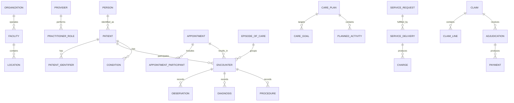

# Health Care Model Pattern: business definitions

These reusable definitions belong to the canonical model. The [industry pattern](../../../industry-patterns/health-care.md) supplies context, variants, selection guidance, and modeling questions. Applications select and specialize these requirements and define their own architecture.

Relationships retain their source expressions and original cardinalities; consult [the manifest](../../model.json) and [semantic review](../../integration-review.md) before interpreting unresolved compound endpoints. Lifecycle descriptions are business guidance, not implementation state machines.

## Actors and roles

| Role | Meaning |
|---|---|
| Patient | Person who is the subject and recipient of care. |
| Related Person | Parent, guardian, caregiver, family member, or representative connected to a Patient. |
| Practitioner | Person qualified or assigned to participate in care. |
| Practitioner Role | Capacity in which a Practitioner acts for an Organization or Facility. |
| Care Coordinator | Party Role coordinating services across an Episode or Case. |
| Referring Provider | Provider requesting evaluation or care from another Provider. |
| Payer | Party responsible for adjudicating or funding covered services. |
| Guarantor | Party financially responsible for charges not paid by a Payer. |

Rule: Patient is a Party Role, not a duplicate of Person. Practitioner identity, employment, credentials, and application-user identity remain separate concerns.

## Relationship model

| Source | Relationship | Target | Cardinality |
|---|---|---|---|
| Person | performs role of | Patient | 1:M over time |
| Patient | has | Patient Identifier | 1:M |
| Patient | relates to | Related Person | M:M |
| Health Care Organization | operates | Facility | 1:M |
| Facility | contains | Location | 1:M recursive |
| Provider | performs | Practitioner Role | 1:M |
| Practitioner Role | acts for | Health Care Organization | M:1 |
| Schedule | allocates availability for | Provider, Service, or Location | M:1 |
| Appointment | includes | Appointment Participant | 1:M |
| Appointment | may result in | Encounter | 1:0..M |
| Patient | participates in | Encounter | 1:M |
| Provider | participates in | Encounter | M:M |
| Episode of Care | groups | Encounter | 1:M |
| Medical Case | concerns | Patient | M:1 |
| Care Team | supports | Episode, Case, or Care Plan | M:1 |
| Care Team | contains | Care Team Member | 1:M |
| Encounter | records | Observation, Diagnosis, Procedure, or Clinical Note | 1:M each |
| Patient | has | Condition | 1:M |
| Diagnosis | may assert | Condition | M:1 |
| Service Request | requests | Health Care Service | M:1 |
| Service Request | may produce | Service Delivery or Procedure | 1:M |
| Care Plan | contains | Care Goal and Planned Activity | 1:M each |
| Service Delivery | occurs within | Encounter, Episode, or Case | M:1 |
| Consent | given by | Patient or Related Person | M:1 |
| Coverage | covers | Patient | M:1 |
| Authorization | authorizes | Service Request or Service Delivery | M:M |
| Service Delivery | produces | Charge | 1:M |
| Claim | contains | Claim Line | 1:M |
| Claim Line | references | Charge or Service Delivery | M:1 |
| Claim | receives | Adjudication | 1:M |
| Adjudication | may produce | Payment | 1:M |
| Provenance | describes | Clinical or administrative record | M:1 |
| Audit Event | records access or action upon | Patient information | M:1 |

## Lifecycle models

### Appointment

Proposed → Booked → Arrived → In Progress → Fulfilled

Exception outcomes: Waitlisted; No Show; Cancelled; Rescheduled.

### Encounter

Planned → Arrived → In Progress → Completed

Exception outcomes: On Hold; Cancelled; Entered in Error.

### Service request

Draft → Active → Accepted → In Progress → Completed

Exception outcomes: On Hold; Revoked; Rejected; Cancelled; Entered in Error.

### Episode of care

Planned → Active → On Hold → Finished

Exception outcomes: Cancelled; Entered in Error.

### Claim

Draft → Submitted → Acknowledged → In Review → Adjudicated → Paid → Closed

Exception outcomes: Rejected; Denied; Partially Paid; Appealed; Voided.

### Consent

Proposed → Active → Inactive

Exception outcomes: Rejected; Revoked; Entered in Error.

## Business events

- Patient Registered or Identity Reconciled
- Appointment Requested, Booked, Rescheduled, or Cancelled
- Patient Arrived
- Encounter Started or Completed
- Condition Recorded
- Observation Recorded or Corrected
- Diagnosis Asserted
- Service or Medication Ordered
- Care Plan Activated
- Consent Granted, Refused, or Revoked
- Authorization Requested, Approved, or Denied
- Service Delivered
- Claim Submitted, Rejected, Adjudicated, or Appealed
- Payment Received
- Protected Record Accessed or Disclosed

## Baseline business and integrity rules

1. A clinical or administrative record must identify its Patient, author or source, time, status, and provenance as applicable.
2. Corrections to signed or finalized clinical records preserve prior versions and record the reason for change.
3. A Provider may act only within an active role, credential, organization, location, and permitted scope.
4. An Encounter cannot be completed before it starts.
5. A Service Delivery must trace to the Patient, performer, service, time, location or channel, and relevant request or plan.
6. Payer Authorization never substitutes for Patient Consent or a clinical order.
7. Consent and access restrictions must be evaluated for the requested purpose, data scope, actor, and time.
8. A Claim Line must trace to a delivered service or valid charge.
9. Paid, allowed, adjustment, and patient-responsibility amounts must reconcile under the applicable adjudication rules.
10. Patient identity merges and splits preserve identifier history and record lineage.
11. Sensitive data collection should be limited to a legitimate purpose and applicable policy.
12. Every access or disclosure requiring audit must create immutable evidence of actor, purpose, subject, action, time, and outcome.
