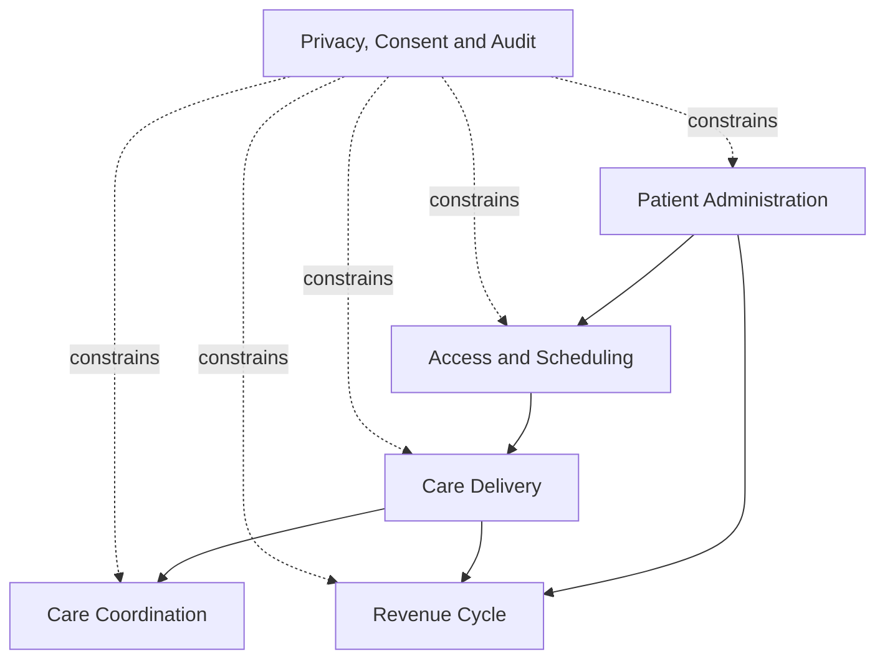
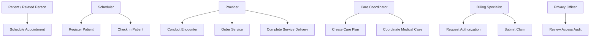
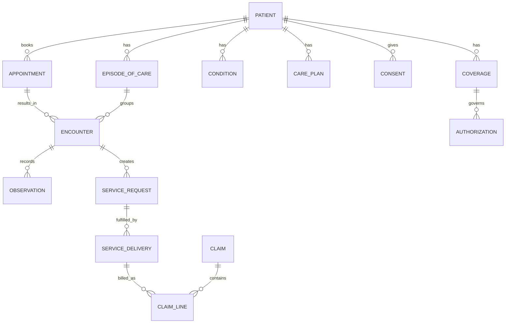
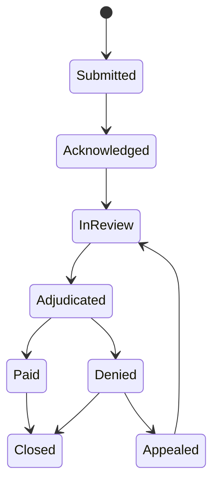

# Health Care Business Diagrams

Business views of the canonical [Health Care requirements](README.md). Implementation and deployment architecture belong to each consuming application. Diagrams summarize the detailed entity, use-case, workflow, and rule definitions; they do not add implementation choices.

## Capability relationships

## Use-case view

## Logical data model

## Key state machines

