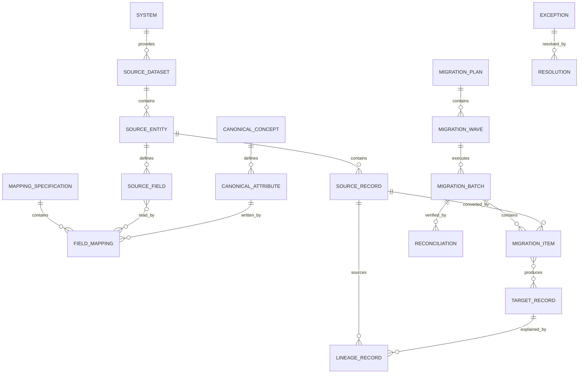

# Real-World Extensions and Legacy Conversion Pattern: business definitions

These reusable definitions belong to the canonical model. The [industry pattern](../../../industry-patterns/legacy-conversion.md) supplies context, variants, selection guidance, and modeling questions. Applications select and specialize these requirements and define their own architecture.

Relationships retain their source expressions and original cardinalities; consult [the manifest](../../model.json) and [semantic review](../../integration-review.md) before interpreting unresolved compound endpoints. Lifecycle descriptions are business guidance, not implementation state machines.

## Core roles

| Role | Meaning |
|---|---|
| Business Owner | Accountable for the meaning and acceptable use of migrated business information. |
| Data Steward | Resolves definitions, mappings, quality issues, matches, and exceptions. |
| Source Custodian | Understands and provides the source system and its operational constraints. |
| Target Owner | Accepts converted data into the target application or canonical model. |
| Migration Operator | Executes approved migration batches and recovery actions. |
| Reviewer/Auditor | Verifies controls, reconciliation, lineage, and evidence. |

## Relationship model

| Source | Relationship | Target | Cardinality |
|---|---|---|---|
| System | provides | Source Dataset | 1:M |
| Source Dataset | contains | Source Entity | 1:M |
| Source Entity | defines | Source Field | 1:M |
| Source Entity | contains | Source Record | 1:M |
| Canonical Concept | defines | Canonical Attribute | 1:M |
| Target Store | contains | Target Record | 1:M |
| Source Record | corresponds through | Record Link | 1:M |
| Target Record or Golden Record | corresponds through | Record Link | 1:M |
| Mapping Specification | contains | Field Mapping | 1:M |
| Field Mapping | reads | Source Field | M:M |
| Field Mapping | writes | Canonical Attribute | M:1 |
| Field Mapping | uses | Transformation Rule or Value Mapping | M:M |
| Data Profile | describes | Dataset, Entity, or Field | M:1 |
| Data Quality Rule | produces | Data Quality Finding | 1:M |
| Migration Plan | contains | Migration Wave | 1:M |
| Migration Wave | executes through | Migration Batch | 1:M |
| Migration Batch | contains | Migration Item | 1:M |
| Migration Item | reads | Source Record | M:1 |
| Migration Item | creates or updates | Target Record | M:0..M |
| Migration Item | produces | Validation Result or Conversion Error | 1:M |
| Exception | is resolved by | Resolution | 1:0..M |
| Lineage Record | connects | Source Field and Target Attribute | M:1 each |
| Reconciliation | evaluates | Migration Batch or Wave | M:1 |
| System of Record Assignment | assigns authority to | System | M:1 |
| Synchronization Contract | connects | Publisher System and Consumer System | M:1 each |
| Change Capture | may create | Conflict | M:0..M |
| Cutover Event | activates | System of Record Assignment | 1:M |
| Decommission Plan | preserves | Archive Package | 1:M |

## Lifecycle models

### Mapping specification

Draft → Reviewed → Approved → Active → Superseded → Retired

### Migration batch

Prepared → Validated → Approved → Running → Completed → Reconciled → Accepted

Exception outcomes: Partially Completed; Failed; Cancelled; Rolled Back.

### Migration item

Pending → Transformed → Validated → Applied → Verified

Exception outcomes: Rejected; Failed; Quarantined; Skipped.

### Exception

Open → Assigned → Investigating → Decision Required → Resolved → Verified → Closed

### Cutover

Planned → Ready → Started → Data Frozen → Final Sync → Verified → Activated → Stabilized → Completed

Exception outcomes: Paused; Failed; Rolled Back.

### Legacy system

Active → Read Only → Archived → Decommissioned

## Business events

- Source Dataset Registered
- Source Profile Completed
- Semantic Issue Identified
- Mapping Proposed, Approved, or Superseded
- Source Extract Frozen
- Migration Batch Started, Completed, Failed, or Rolled Back
- Record Converted, Rejected, Quarantined, or Corrected
- Match Proposed, Accepted, or Rejected
- Identity Merged or Split
- Reconciliation Passed or Failed
- Exception Opened or Resolved
- Cutover Authorized, Activated, or Rolled Back
- System of Record Changed
- Legacy System Set Read Only, Archived, or Decommissioned

## Baseline integrity and governance rules

1. Every Target Record created by conversion must trace to its Source Record, mapping version, transformation version, and batch.
2. Source data is never silently overwritten during profiling or conversion.
3. Mapping changes require a new version and do not rewrite evidence from prior batches.
4. Every ignored Source Field or excluded record population requires an explicit disposition and reason.
5. Defaulted, inferred, corrected, and manually entered values must remain distinguishable from observed source values.
6. A Migration Batch must identify immutable source scope and executable mapping versions.
7. Re-running the same approved batch input must be idempotent or declare and control its non-idempotent effects.
8. Batch acceptance requires agreed validation and reconciliation criteria to pass or documented exceptions to be approved.
9. Record-count reconciliation alone is insufficient when balances, relationships, classifications, or business meaning are material.
10. Match and merge decisions preserve candidates, evidence, decision maker, and prior identity history.
11. During coexistence, each synchronized fact must have a declared owner and conflict policy.
12. Cutover cannot proceed until rollback, access, monitoring, support, and reconciliation controls are ready.
13. Decommissioning requires verified archive, retention, legal-hold, access, and dependency disposition.
14. Sensitive source data may be copied only into authorized environments and retained only for the approved purpose and period.
