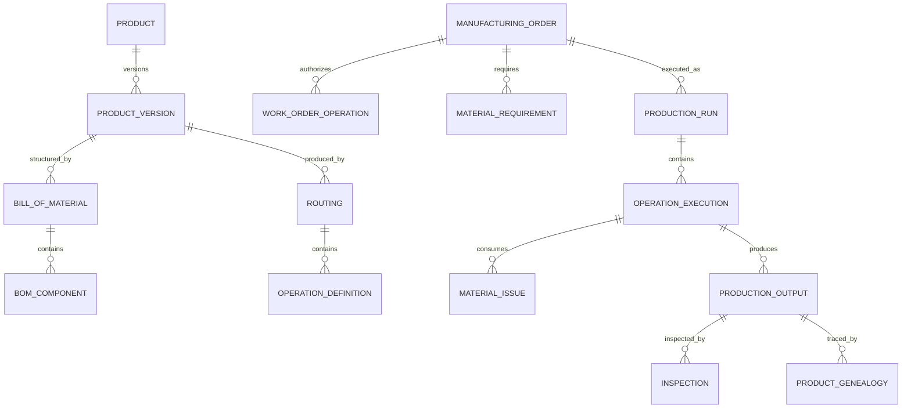

# Manufacturing Model Pattern: business definitions

These reusable definitions belong to the canonical model. The [industry pattern](../../../industry-patterns/manufacturing.md) supplies context, variants, selection guidance, and modeling questions. Applications select and specialize these requirements and define their own architecture.

Relationships retain their source expressions and original cardinalities; consult [the manifest](../../model.json) and [semantic review](../../integration-review.md) before interpreting unresolved compound endpoints. Lifecycle descriptions are business guidance, not implementation state machines.

## Roles

| Role | Meaning |
|---|---|
| Manufacturer | Organization responsible for producing or assembling products. |
| Product Owner | Role governing product purpose, market, and lifecycle. |
| Design Engineer | Role defining product design and specifications. |
| Manufacturing Engineer | Role defining producibility, routings, tooling, and work instructions. |
| Planner | Role balancing demand, materials, capacity, and order timing. |
| Production Supervisor | Role authorizing and coordinating shop-floor execution. |
| Operator | Person performing or recording production work. |
| Quality Inspector | Qualified role evaluating conformance. |
| Maintenance Technician | Role servicing production assets and tools. |
| Supplier | Party providing material, components, or outsourced operations. |
| Customer | Party purchasing or receiving manufactured output. |

Rule: Person identity, employee relationship, application user, qualification, and assigned production role remain separate and effective-dated.

## Relationship model

| Source | Relationship | Target | Cardinality |
|---|---|---|---|
| Product | has | Product Version | 1:M |
| Product Version | has | Product Specification | 1:M |
| Product Version | governed by | Bill of Material and Routing | 1:M versions |
| Bill of Material | contains | BOM Component | 1:M |
| BOM Component | references | Part Revision | M:1 |
| Engineering Change | changes | Product, Part, BOM, Routing, or Specification | M:M |
| Routing | contains | Operation Definition | 1:M |
| Operation Definition | has | Resource Requirement | 1:M |
| Facility | contains | Work Center | 1:M |
| Work Center | contains | Machine Asset | 1:M |
| Manufacturing Requirement | produces | Manufacturing Order | 1:M |
| Manufacturing Order | contains | Work Order Operation | 1:M |
| Manufacturing Order | contains | Material Requirement | 1:M |
| Material Requirement | receives | Material Reservation and Issue | 1:M |
| Manufacturing Order | has | Production Run | 1:M |
| Work Order Operation | receives | Operation Execution | 1:M |
| Operation Execution | consumes | Material Issue | 1:M |
| Operation Execution | produces | Production Output | 1:M |
| Operation Execution | records | Labor, Machine, and Process Measurement | 1:M each |
| Production Output | receives | Inspection | 1:M |
| Inspection | contains | Inspection Result | 1:M |
| Nonconformance | concerns | Material, Output, Process, or Asset | M:1 |
| Product Genealogy | links | Input to Output | M:M |
| Product Output | becomes | Inventory Item or Deployment | 1:M |
| Deployed Product | records | Product Usage or Field Issue | 1:M |

## Lifecycle models

### Engineering change

Proposed → Impact Analysis → Review → Approved → Scheduled → Implemented → Verified → Closed

Exception outcomes: Rejected; On Hold; Cancelled; Superseded.

### Manufacturing order

Planned → Firm → Released → In Production → Completed → Closed

Exception outcomes: On Hold; Shortage; Cancelled; Partially Completed; Terminated.

### Work order operation

Pending → Ready → Setup → Running → Inspection → Completed

Exception outcomes: Blocked; Paused; Rework; Skipped; Cancelled.

### Material lot

Created/Received → Available → Reserved → Issued/Consumed

Exception outcomes: Quarantined; Rejected; Expired; Reworked; Scrapped.

### Nonconformance

Open → Contained → Investigating → Disposition Approved → Corrected/Accepted/Scrapped → Closed

## Business events

- Product Version or Part Revision Released
- BOM, Routing, Specification, or Work Instruction Changed
- Engineering Change Proposed, Approved, or Implemented
- Demand Created or Forecast Changed
- Manufacturing Order Planned, Released, Held, Completed, or Cancelled
- Material Reserved, Issued, Returned, Transferred, or Scrapped
- Production Run or Operation Started, Paused, Resumed, or Completed
- Setup Completed
- Process Measurement Recorded
- Output Produced, Serialized, Accepted, Reworked, or Scrapped
- Inspection Completed
- Nonconformance Opened, Dispositioned, or Closed
- Machine Breakdown or Maintenance Work Order Opened
- Product Deployed, Used, Returned, or Reported Failed

## Baseline business and integrity rules

1. Released production must reference approved Product, Part, BOM, Routing, Specification, and instruction versions effective for the Order.
2. Engineering changes preserve prior versions, effectivity, approvals, impact analysis, and implementation evidence.
3. A Manufacturing Order identifies product version, quantity, facility, dates, unit, and source demand before release.
4. Required material, capacity, tools, instructions, qualifications, and quality plans must be available or explicitly exceptioned before an Operation becomes Ready.
5. Material Issues preserve Part Revision, quantity, unit, lot or serial, source location, order, operation, time, and issuer.
6. Substituted material must satisfy an approved alternate or deviation with traceable authorization.
7. Production Output cannot exceed recorded input and process logic without an explained yield, co-product, by-product, or adjustment.
8. Lot- or serial-controlled output must preserve genealogy to relevant inputs, Operations, Assets, tools, personnel, and inspections.
9. Operators and inspectors may act only under active role, qualification, assignment, and segregation-of-duty rules.
10. Critical Process Measurements outside approved limits trigger the defined hold, review, or nonconformance process.
11. Inspection results use the Quality Plan and limits effective at inspection or production time.
12. Nonconforming material cannot become available inventory without approved disposition and evidence.
13. Rework is authorized work with instructions, execution records, inspection, cost, and genealogy; it is not silent correction.
14. Completed production records are immutable; corrections use attributed adjustments or superseding records.
15. Machine Assets and Tools with blocking maintenance, calibration, or certification conditions cannot be scheduled for governed work.
16. Inventory balances reconcile to receipts, issues, output, transfers, returns, adjustments, and scrap.
17. Production quantities, labor, machine time, material consumption, scrap, and overhead retain the evidence needed for costing.
18. Deployed serialized or lot-controlled output remains traceable to production and field events.
