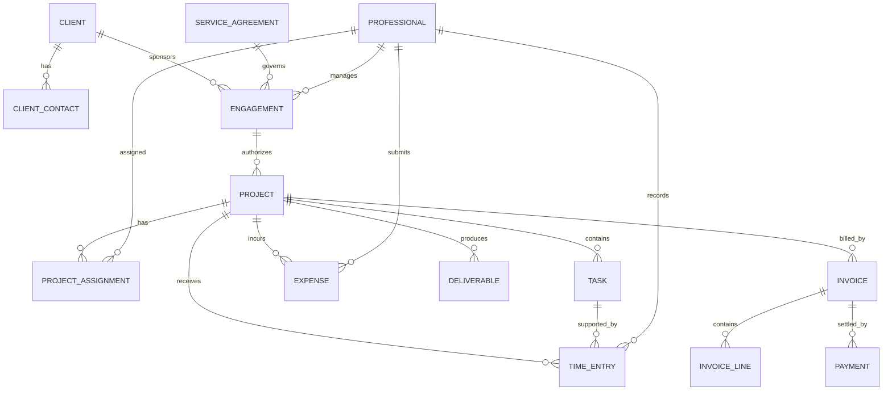

# Professional Services Pattern: business definitions

These reusable definitions belong to the canonical model. The [industry pattern](../../../industry-patterns/professional-services.md) supplies context, variants, selection guidance, and modeling questions. Applications select and specialize these requirements and define their own architecture.

Relationships retain their source expressions and original cardinalities; consult [the manifest](../../model.json) and [semantic review](../../integration-review.md) before interpreting unresolved compound endpoints. Lifecycle descriptions are business guidance, not implementation state machines.

## Relationship model

| Source | Relationship | Target | Cardinality |
|---|---|---|---|
| Client | has | Client Contact | 1:M |
| Client | sponsors | Engagement | 1:M |
| Service Agreement | governs | Engagement | 1:M |
| Professional | manages | Engagement | 1:M |
| Engagement | authorizes | Project | 1:M |
| Project | has | Project Assignment | 1:M |
| Professional | participates through | Project Assignment | 1:M |
| Project | contains | Task | 1:M |
| Project | receives | Time Entry | 1:M |
| Task | is supported by | Time Entry | 1:M |
| Professional | records | Time Entry | 1:M |
| Project | incurs | Expense | 1:M |
| Professional | submits | Expense | 1:M |
| Project | produces | Deliverable | 1:M |
| Time Entry, Expense, or Deliverable | receives | Approval | 1:M |
| Client | receives | Invoice | 1:M |
| Project | is billed by | Invoice | 1:M |
| Invoice | contains | Invoice Line | 1:M |
| Invoice | is settled by | Payment | 1:M |
| Billing Rate | prices | Project Assignment or Invoice Line | 1:M |

## Important relationship roles

- Client sponsors Engagement.
- Engagement is governed by Service Agreement.
- Engagement authorizes Project or Matter.
- Project contains Task.
- Professional receives Project Assignment.
- Professional performs Task.
- Time Entry and Expense record work against an authorized work unit.
- Approval accepts or rejects Time Entry, Expense, Deliverable, or Invoice.
- Billing Event generates Invoice Line.
- Invoice Line bills approved time, expense, deliverable, or milestone.
- Payment settles Invoice.
