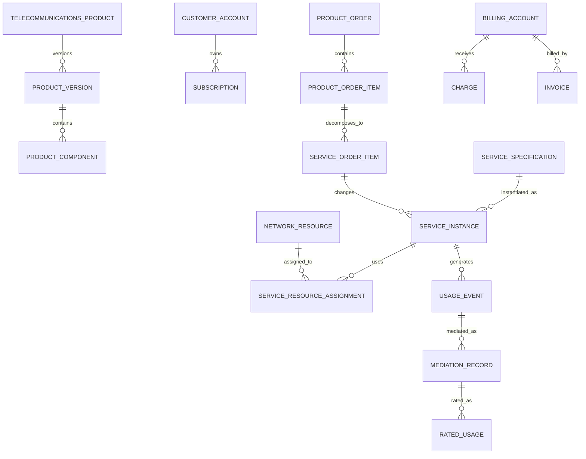

# Telecommunications Model Pattern: business definitions

These reusable definitions belong to the canonical model. The [industry pattern](../../../industry-patterns/telecommunications.md) supplies context, variants, selection guidance, and modeling questions. Applications select and specialize these requirements and define their own architecture.

Relationships retain their source expressions and original cardinalities; consult [the manifest](../../model.json) and [semantic review](../../integration-review.md) before interpreting unresolved compound endpoints. Lifecycle descriptions are business guidance, not implementation state machines.

## Actors and roles

| Role | Meaning |
|---|---|
| Communications Service Provider | Party offering and operating telecommunications services. |
| Customer | Party purchasing or consuming a product or service. |
| Subscriber | Party holding a Subscription. |
| Account Holder | Party responsible for a Customer or Billing Account. |
| Service User | Person, organization, device, or system using a Service. |
| Service Provider | Party technically responsible for all or part of a Service. |
| Network Operator | Party operating network infrastructure or a network domain. |
| Wholesale Partner | Provider supplying or purchasing wholesale services. |
| Dealer or Agent | Intermediary selling or servicing offerings. |
| Field Technician | Role installing, testing, repairing, or recovering resources. |
| Network Engineer | Role designing and changing services or network resources. |
| Service Assurance Agent | Role receiving, diagnosing, and resolving service problems. |

Rule: Customer, Subscriber, Account Holder, Service User, Contact, and authenticated User are distinct Party Roles and may be performed by different Parties.

## Relationship model

| Source | Relationship | Target | Cardinality |
|---|---|---|---|
| Telecommunications Product | has | Product Version | 1:M |
| Product Version | contains | Product Component | 1:M |
| Product Offering | offers | Product Version | M:1 |
| Product Component | maps to | Service Specification | M:M |
| Service Specification | requires | Resource Specification | M:M |
| Customer | owns | Customer Account | 1:M |
| Customer Account | has | Billing Account | 1:M |
| Customer Agreement | governs | Subscription | 1:M |
| Subscription | instantiates | Product Offering | M:1 |
| Service Request | receives | Service Qualification | 1:M |
| Product Order | contains | Product Order Item | 1:M |
| Product Order Item | decomposes into | Service Order Item | 1:M |
| Service Order | contains | Service Order Item | 1:M |
| Service Order Item | creates or changes | Service Instance | M:1 |
| Service Instance | instantiates | Service Specification | M:1 |
| Service Instance | has | Service Characteristic | 1:M |
| Service Instance | uses | Network Resource | M:M through assignment |
| Circuit | connects | Network Endpoint | M:M |
| Resource Reservation | reserves | Network Resource or capacity | M:1 |
| Service Order | contains | Provisioning Task | 1:M |
| Service Activation | activates | Service Instance | M:1 |
| Trouble Ticket | concerns | Service Instance | M:1 |
| Alarm | concerns | Network Resource | M:1 |
| Alarm or Outage | creates | Service Impact | 1:M |
| Service Instance | produces | Usage Event | 1:M |
| Usage Event | produces | Mediation Record | 1:M |
| Mediation Record | produces | Rated Usage | M:M |
| Rated Usage | produces | Charge | 1:M |
| Billing Account | receives | Charge, Invoice, and Payment | 1:M each |
| Interconnect Agreement | governs | Partner Service and Settlement | 1:M |

## Lifecycle models

### Product order

Draft → Submitted → Acknowledged → In Progress → Completed → Closed

Exception outcomes: Pending Information; Rejected; Held; Partially Completed; Cancelled; Failed.

### Service order item

Pending → Designed → Resource Assigned → Provisioning → Testing → Activated → Completed

Exception outcomes: Blocked; Fallout; Rework; Cancelled; Failed.

### Service instance

Feasibility → Designed → Reserved → Provisioning → Testing → Active

Operational outcomes: Suspended; Restricted; Migrating; Degraded; Disconnected; Retired.

### Trouble ticket

Reported → Validated → Diagnosing → Repairing → Monitoring → Resolved → Closed

Exception outcomes: Awaiting Customer; Awaiting Partner; Duplicate; Cancelled; Reopened.

### Usage record

Received → Validated → Normalized → Correlated → Rated → Billed → Archived

Exception outcomes: Duplicate; Rejected; Suspended; Reprocessed.

## Business events

- Offering Published, Changed, or Withdrawn
- Service Qualification Requested or Completed
- Quote Issued or Accepted
- Product Order Submitted, Changed, Cancelled, or Completed
- Service Order Decomposed
- Resource Reserved, Assigned, Configured, Recovered, or Retired
- Number or Address Reserved, Assigned, Ported, Released, or Quarantined
- Field Appointment Scheduled or Completed
- Service Tested, Activated, Suspended, Resumed, Migrated, or Disconnected
- Alarm Raised, Acknowledged, Correlated, or Cleared
- Trouble Reported, Resolved, or Reopened
- Outage Started or Restored
- Usage Event Received, Rejected, Reprocessed, or Rated
- Allowance Consumed or Reset
- Charge Created, Adjusted, or Reversed
- Invoice Issued or Payment Received
- Partner Usage Reconciled or Settlement Completed

## Baseline business and integrity rules

1. An Offering must reference approved Product and pricing versions effective for its market, channel, and order date.
2. Qualification results retain the requested characteristics, location, evidence sources, constraints, result, and validity period.
3. A Product Order identifies Customer Account, action, Offering or Subscription, requested dates, channel, and agreement before submission.
4. Order decomposition preserves traceability from Product Order Item to all Service and Resource Order Items.
5. Order dependencies and completion rules prevent activation when blocking predecessor work is incomplete.
6. A Service Instance identifies its Specification version, Customer or Subscription context, service location, lifecycle state, and effective dates.
7. Resource assignments cannot exceed available capacity or overlap incompatibly unless governed sharing rules allow it.
8. Communication Identifiers must be unique within their governed namespace and preserve reservation, assignment, portability, quarantine, and release history.
9. Service activation requires the approved configuration, completed blocking tasks, valid resource assignments, required testing, and authorized release.
10. Actual Service Configuration is versioned; changes preserve the configuration and resources effective at any historical time.
11. Trouble, alarm, outage, impact, and SLA records preserve independent status and evidence.
12. Usage Events preserve source, source reference, event time, received time, quantity, unit, service identity, and processing lineage.
13. Duplicate usage must be detected before rating or billing using governed uniqueness and correction rules.
14. Rating retains the usage inputs, allowances, rule version, rate, currency, rounding, taxes, discounts, and result.
15. Charges trace to a Subscription, Service, Order, usage, adjustment, or contractual source.
16. Suspended, disconnected, migrated, or terminated Services follow explicit usage, billing, identifier, and resource-release rules.
17. Manual adjustments require reason, authority, source charge or invoice, effective date, and audit evidence.
18. Partner traffic and settlement reconcile to exchanged records, agreement terms, disputes, and final obligations.
19. Finalized orders, configurations, usage lineage, invoices, and assurance evidence are corrected by amendment or supersession, not overwrite.
20. Access to Customer communications, location, usage, identifiers, and network data follows purpose, role, jurisdiction, and minimum-necessary rules.
