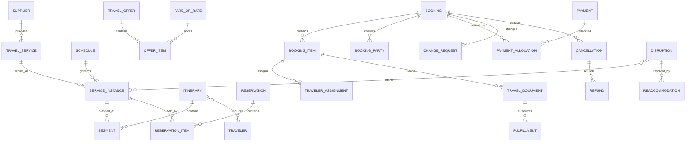

# Travel Model Pattern: business definitions

These reusable definitions belong to the canonical model. The [industry pattern](../../../industry-patterns/travel.md) supplies context, variants, selection guidance, and modeling questions. Applications select and specialize these requirements and define their own architecture.

Relationships retain their source expressions and original cardinalities; consult [the manifest](../../model.json) and [semantic review](../../integration-review.md) before interpreting unresolved compound endpoints. Lifecycle descriptions are business guidance, not implementation state machines.

## Travel roles

| Role | Meaning |
|---|---|
| Traveler | Person who consumes the travel service. |
| Customer | Party purchasing, arranging, or owning the commercial relationship. |
| Travel Arranger | Party or role acting for one or more Travelers. |
| Supplier | Airline, rail operator, hotel, vehicle provider, cruise line, tour operator, activity provider, or other service provider. |
| Distributor | Party presenting and selling supplier or packaged travel services. |
| Agent | Person or organization assisting search, booking, servicing, or disruption handling. |
| Payer | Party providing payment; may differ from Customer and Traveler. |
| Beneficiary | Party receiving refund, compensation, insurance, or loyalty benefit. |

Rule: Traveler, Customer, Booker, Arranger, Payer, and Beneficiary may be different Parties.

## Relationship model

| Source | Relationship | Target | Cardinality |
|---|---|---|---|
| Supplier | defines | Travel Product or Service | 1:M |
| Travel Service | occurs as | Service Instance | 1:M |
| Schedule | generates or governs | Service Instance | 1:M |
| Service Instance | uses | Location | M:M |
| Availability | describes | Service Instance or inventory class | M:1 |
| Travel Offer | contains | Offer Item | 1:M |
| Offer Item | proposes | Service Instance or Ancillary Service | M:1 |
| Fare or Rate | prices | Offer Item | 1:M |
| Offer Item | contains | Price Component | 1:M |
| Itinerary | contains | Segment | 1:M ordered |
| Segment | references | Service Instance | M:0..1 |
| Itinerary | includes | Traveler | M:M |
| Segment | connects through | Connection | 1:M |
| Reservation | contains | Reservation Item | 1:M |
| Reservation Item | holds | Service Instance inventory | M:1 |
| Accepted Offer or Reservation | produces | Booking | 1:0..1 |
| Booking | contains | Booking Item | 1:M |
| Booking | has | Booking Party | 1:M |
| Booking Item | receives | Traveler Assignment | 1:M |
| Booking Item | receives | Supplier Confirmation | 1:M |
| Booking | receives | Payment | M:M through Payment Allocation |
| Booking Item | issues | Travel Document | 1:M |
| Ticket | contains | Ticket Coupon | 1:M |
| Travel Document | authorizes | Fulfillment | 1:M |
| Booking or Booking Item | receives | Change Request | 1:M |
| Accepted Change Request | produces | Booking Change | 1:1 |
| Booking or Booking Item | receives | Cancellation | 1:M |
| Cancellation or Booking Change | may produce | Refund | 1:M |
| Disruption | affects | Service Instance | M:M |
| Disruption | may produce | Reaccommodation or Duty of Care Case | 1:M |

## Lifecycle models

### Travel offer

Draft → Priced → Available → Selected → Accepted

Exception outcomes: Expired; Withdrawn; Repriced; Unavailable.

### Reservation

Requested → Held → Confirmed → Converted

Exception outcomes: Waitlisted; Rejected; Expired; Released; Cancelled.

### Booking

Draft → Pending Confirmation → Confirmed → Ticketed/Fulfilled → In Travel → Completed

Exception outcomes: On Hold; Partially Confirmed; Changed; Partially Cancelled; Cancelled.

### Travel document

Pending → Issued → Active → Used

Exception outcomes: Exchanged; Refunded; Voided; Expired.

### Change request

Requested → Priced → Accepted → Applied → Completed

Exception outcomes: Declined; Expired; Withdrawn; Failed.

### Refund

Requested → Validated → Approved → Processing → Completed

Exception outcomes: Rejected; Failed; Reversed.

### Disruption

Detected → Assessed → Options Available → Traveler Contacted → Resolved → Closed

Exception outcomes: Escalated; Unresolved; Duty of Care Active.

## Business events

- Search Requested
- Offer Created, Repriced, Selected, Accepted, or Expired
- Availability Checked
- Inventory Held, Confirmed, Released, or Waitlisted
- Booking Created, Confirmed, Changed, Cancelled, or Completed
- Supplier Confirmation Received or Rejected
- Payment Authorized, Captured, Failed, or Refunded
- Ticket or Voucher Issued, Exchanged, Voided, Used, or Refunded
- Traveler Checked In, Boarded, Arrived, or No-Show
- Service Delayed, Cancelled, Overbooked, or Unavailable
- Connection Missed
- Reaccommodation Offered or Accepted
- Duty of Care Case Opened or Closed
- Supplier Settlement Completed

## Baseline business and integrity rules

1. An Offer must identify its supplier or seller, included services, Travelers or occupancy assumptions, currency, price components, conditions, and expiration.
2. Availability, price, tax, and rules must be revalidated before Booking confirmation.
3. A Booking retains the accepted Product, service, schedule, price, tax, rule, and participant snapshots required to explain the transaction.
4. Traveler identity and required documents must match supplier, destination, and jurisdictional requirements for the service date.
5. Reservation expiry releases held inventory unless a confirmed Booking or explicit extension exists.
6. One Booking may contain several Suppliers, Travelers, Segments, payments, currencies, and fulfillment documents when the business model supports them.
7. Payment capture cannot exceed authorized or payable value unless an approved change creates additional collection.
8. A Travel Document must trace to a confirmed Booking Item and the Party entitled to use it.
9. Fulfillment cannot exceed the booked quantity or entitlement.
10. Changes and cancellations preserve prior commercial and itinerary versions.
11. Refund amount must be explainable from unused value, rules, penalties, supplier response, prior refunds, and currency treatment.
12. Disruption handling distinguishes supplier-caused, traveler-requested, protected-connection, and force-majeure outcomes.
13. Sensitive identity and travel-document data is collected and disclosed only for an authorized purpose and minimum scope.
14. Supplier settlement, commission, markup, payment, exchange, and refund amounts must reconcile to their source transactions.
