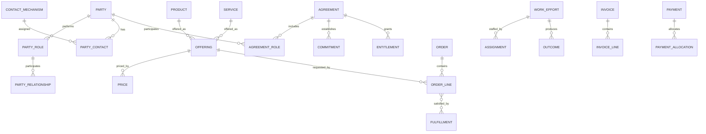

# Cross-domain relationships

A connected view of the shared canonical concepts. Original expressions and unresolved endpoints remain recorded in [model.json](model.json) and the [integration review](integration-review.md).

| Source | Relationship | Target | Cardinality |
|---|---|---|---|
| Party | specializes as | Person or Organization | 1:0..1 each |
| Party | performs | Party Role | 1:M |
| Party Role | relates to | Party Role | M:M through Party Relationship |
| Party | uses | Contact Mechanism | M:M through Party Contact |
| Classification Scheme | contains | Classification | 1:M |
| Classification | has parent | Classification | M:0..1 |
| Product | contains | Product | M:M through Product Component |
| Offering | makes available | Product or Service | M:1 |
| Offering | has | Price | 1:M |
| Agreement | includes | Agreement Role | 1:M |
| Party | participates through | Agreement Role | 1:M |
| Agreement | contains | Agreement Term | 1:M |
| Agreement | establishes | Commitment or Entitlement | 1:M |
| Subscription | grants | Entitlement | 1:M |
| Request | may become | Order | 1:0..1 |
| Order | contains | Order Line | 1:M |
| Order Line | requests | Offering | M:1 |
| Fulfillment | satisfies | Order Line or Commitment | M:M |
| Business Event | may trigger | Work Effort | 1:M |
| Work Effort | contains | Work Effort | 1:M |
| Party Role | receives | Assignment | 1:M |
| Assignment | allocates to | Work Effort | M:1 |
| Work Effort | produces | Outcome | 1:M |
| Status Transition | changes | Status Type | from/to |
| Business subject | records | Status History | 1:M |
| Charge | may arise from | Order Line, Usage, Fulfillment, or Event | M:1 |
| Invoice | contains | Invoice Line | 1:M |
| Invoice Line | explains | Charge | M:1 |
| Payment | applies through | Payment Allocation | 1:M |
| Payment Allocation | settles | Invoice or Charge | M:1 |

